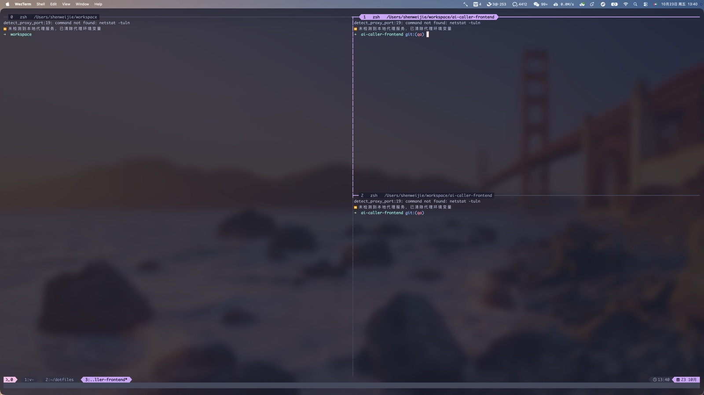

# dotfiles

WezTerm + tmux + Hammerspoon 的个人终端配置。配置源文件统一存放在本目录，通过符号链接接入各个程序的默认配置位置。



## 内容一览

| 目录 | 用途 | 链接到的位置 |
|---|---|---|
| `wezterm/` | 终端外观、四套主题、主题切换脚本 | `~/.config/wezterm` |
| `tmux/tmux.conf` | tmux 布局、快捷键、插件 | `~/.tmux.conf` |
| `hammerspoon/` | `Option + U` 呼出/隐藏 WezTerm | `~/.hammerspoon/init.lua`、`~/.hammerspoon/wezterm_hotkey.lua` |
| `install.sh` | 一键建立上述链接 | - |

## 依赖

在新机器上使用前安装：

```bash
brew install --cask wezterm hammerspoon
brew install tmux
```

字体需另行安装 **Monaco Nerd Font**，并放到 `~/Library/Fonts/` 或通过字体册安装。中文使用系统自带 **PingFang SC**，无额外依赖。

tmux 首次启动需安装插件（tmux-resurrect 等）：在 tmux 中按 `Ctrl + A`，再按 `I`。插件脚本依赖 `~/.tmux/plugins/tpm`。

## 恢复步骤

### 1. 获取配置

将本目录放在任意位置，例如：

```bash
cd ~
git clone <本仓库地址> dotfiles
```

或直接从旧机器复制整个 `~/dotfiles` 目录。

### 2. 建立链接

```bash
cd ~/dotfiles
./install.sh
```

脚本会：
- 若目标已是符号链接，直接替换；
- 若目标是普通文件或目录，先备份为 `<目标>.backup.<时间戳>`；
- 为 WezTerm 目录、`.tmux.conf` 及两个 Hammerspoon 文件创建符号链接。

### 3. 授权与额外设置

1. 打开 Hammerspoon，按提示在 **系统设置 → 隐私与安全性 → 辅助功能** 中允许 Hammerspoon。
2. 在 **Dock → WezTerm → 选项 → 分配给 → 所有桌面**，启用跨桌面呼出。
3. 重新打开 WezTerm，或按 `Ctrl + Shift + R` 重载配置。
4. 在 tmux 中按 `Ctrl + A` 再按 `r` 重载 tmux 配置。

## 使用说明

### 呼出 / 隐藏终端

- `Option + U`：呼出 WezTerm，最大化并置前；再次按下则隐藏。
- 首次启动期间重复按键会被合并，不会重复启动窗口。
- 若 Hammerspoon 未授予辅助功能权限，呼出可能无法移动或聚焦窗口。

### tmux 快捷键

前缀键为 `Ctrl + A`（原 `Ctrl + B` 已解绑），再按一次 `Ctrl + A` 会把该键原样发给 shell。

**无需前缀**

| 快捷键 | 功能 |
|---|---|
| `Option + H/J/K/L` | 按方向切换窗格 |
| `Option + Shift + H/J/K/L` | 与相邻窗格交换位置 |
| `Option + M` | 当前窗格最大化 / 还原 |
| `Option + Shift + C` | 关闭当前窗格 |
| `Ctrl + Option + H/J/K/L` | 调整窗格大小，每次 10 格 |
| `Option + 1…9` | 跳到第 1–9 个窗口 |
| `Option + 0` | 跳到上一个窗口 |
| `Option + Shift + ! @ # $ % ^ & * (` | 把当前窗口换到第 1–9 位 |
| `Ctrl + K` | 清屏并清空回滚历史 |
| `Ctrl + Option + R` | 重新加载 `~/.tmux.conf` |

**前缀 + 按键**

| 快捷键 | 功能 |
|---|---|
| `Enter` | 智能分屏：较宽时左右分，较窄时上下分 |
| `\|` 或 `%` | 左右分屏（沿用当前路径） |
| `"` | 上下分屏（沿用当前路径） |
| `-` | 切换为平铺布局 |
| `c` | 新建窗口（沿用当前路径） |
| `0` | 跳到上一个窗口 |
| `r` | 重新加载配置 |
| `S` | 抓取当前窗格内容到 `~/tmux.log` |
| `I` | 安装 tmux 插件（首次，tpm） |

**鼠标与复制**

- 鼠标已开启：点选窗格、拖拽调整、滚轮翻历史。
- 复制模式为 vi 键位：`v` 开始选择，`y` 复制到系统剪贴板；`q` 退出。

**常用默认键（未改动）**

| 快捷键 | 功能 |
|---|---|
| `前缀 + n` / `p` | 下一个 / 上一个窗口 |
| `前缀 + ,` / `.` | 重命名窗口 / 移动到指定编号 |
| `前缀 + x` | 关闭窗格（有确认） |
| `前缀 + &` | 关闭窗口（有确认） |
| `前缀 + d` | 脱离会话 |
| `前缀 + [` | 进入复制模式 |
| `前缀 + t` | 时钟 |

### 切换主题

```bash
~/.config/wezterm/set-theme catppuccin-mocha
~/.config/wezterm/set-theme gruvbox-dark-hard
~/.config/wezterm/set-theme rose-pine-moon
~/.config/wezterm/set-theme everforest
```

命令同时更新 WezTerm 与当前 tmux 服务。当前主题记录在 `wezterm/current-theme`。

主题可选项及配色细节见 [`wezterm/README.md`](wezterm/README.md)。

### 调整外观

字体、字号、透明度、模糊强度都在 `wezterm/ui.lua` 中，对所有主题生效，例如：

```lua
font = wezterm.font_with_fallback({ "Monaco Nerd Font", "PingFang SC", "Monaco" }),
font_size = 14,
window_background_opacity = 0.82,
macos_window_background_blur = 35,
```

## 目录结构

```text
dotfiles/
├── install.sh
├── README.md
├── images.jpg
├── hammerspoon/
│   ├── init.lua
│   └── wezterm_hotkey.lua
├── tmux/
│   └── tmux.conf
└── wezterm/
    ├── wezterm.lua
    ├── ui.lua
    ├── current-theme
    ├── set-theme
    ├── README.md
    └── themes/
```

## 注意

- `install.sh` 会替换现有配置：遇到普通文件或目录时，复制到本目录下 `.backup/<时间戳>/` 后再建立链接，原文件不会被删除到仓库之外；遇到旧符号链接则直接替换。
- `.backup/` 已加入 `.gitignore`，不会提交到仓库。
- 本机首次迁移前的原始配置另行保存在 `~/dotfiles-backup/20261023/`，仅作备份，不参与运行。
- Hammerspoon 的 `Spoons/` 目录不在本仓库内，如使用额外 Spoon 需单独同步。
- `~/dotfiles` 不是 Git 仓库；如需跨机器同步，可自行 `git init` 后推送到远端。
- 主题切换脚本中的 `set-theme` 依赖 WezTerm 配置目录结构，链接后应以 `~/.config/wezterm/set-theme` 调用。
